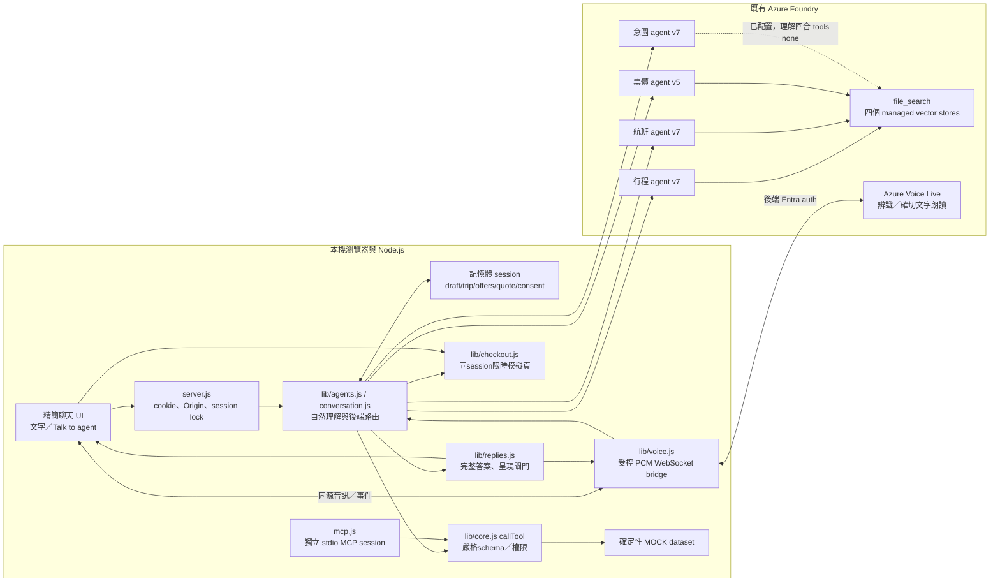
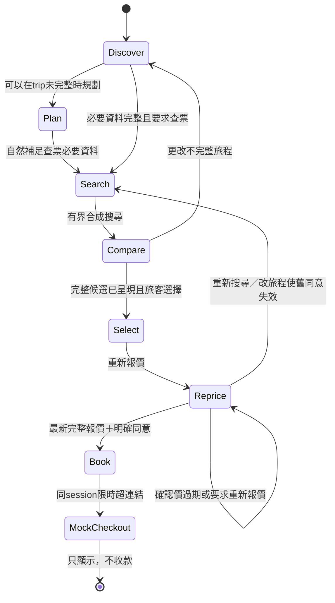
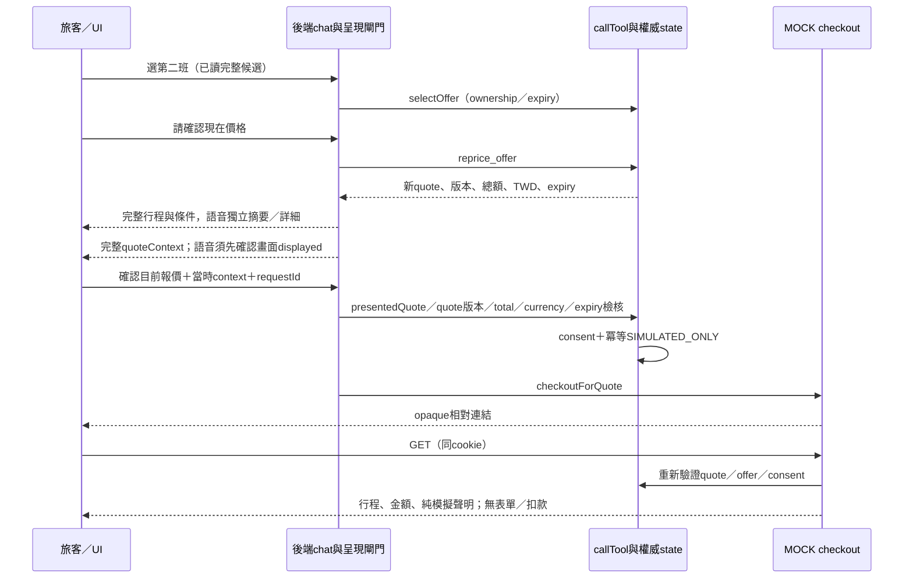
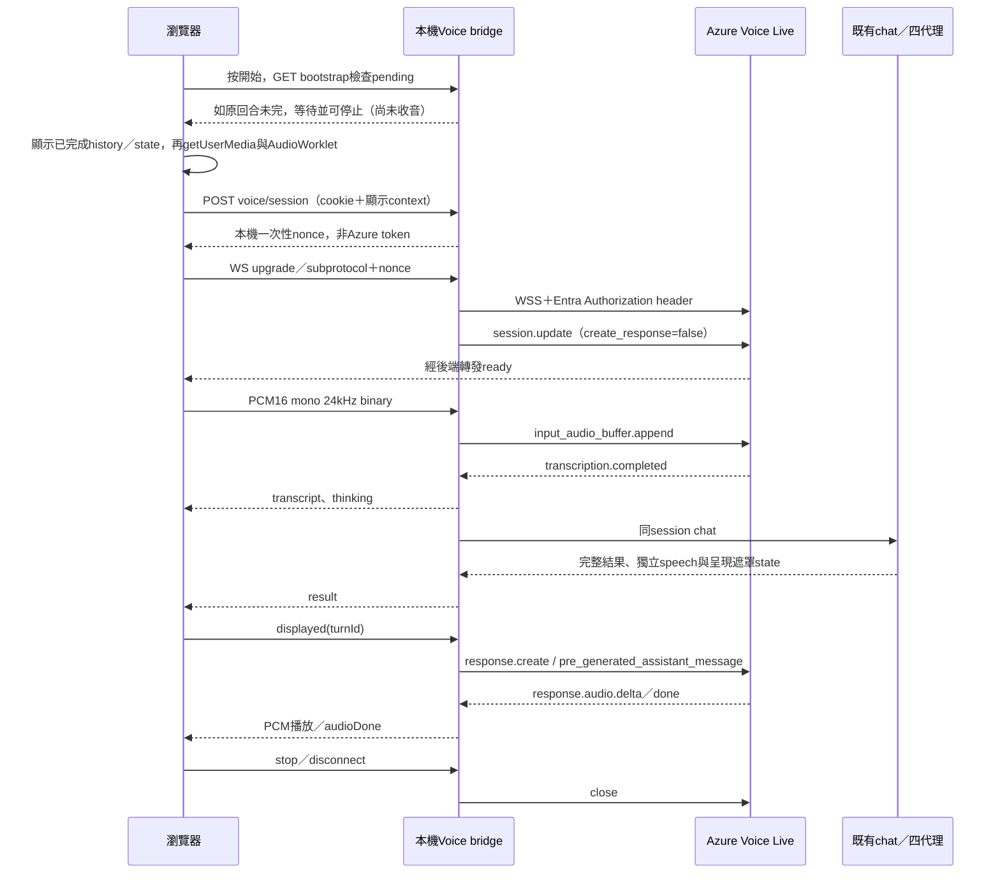

# Ni Airlines AI 旅遊規劃師：系統設計

**原始文件快照：2026-10-19；現行交付契約更新至2026-10-24。** 本文件描述 `C:\Code\travelagent` 已實作的本機 POC，不是尚未部署的目標架構。主要讀者為應用、AI、資安及方案架構審閱者；歷史測試紀錄保留當時版本與數字。

**最新會員偏好分區版：`1.0.8/a15841e3240904c1`。**catalog提供雙語compact會員偏好summary，與Current trip分開；Home city只作profile，明示非過往對話記憶。可信登入HTTP chat啟用既有會員排序，public state的ranking metadata僅在實際比較≥2offers且member／trip／meetings／offer IDs相符時投影。Applied note重用既有排序說明、只顯示一次，未提供會議不宣稱meeting-fit。未改語音協定或新增記憶儲存，詳見[目前本機版本](CURRENT-VERSION.md)。下段為前版啟用歷史。

3100目前為已授權啟用的隔離會員／Ni候選，最新對話優先版面`1.0.8/b7e71a814d8692a4`。商務mapping仍8/8/8/6，第五條managed voice依session locale選zh8／en9，同item ASR final作唯一backend輸入；保留有界收音credit與SDK send完成ACK，安全上限不變。Business identity在啟動期載入，managed bridge共用同一server credential，避免收音熱路徑的冷module解析。最新單次paid診斷重現ACK timeout後，離線已修可重現的冷resolver阻塞；使用者另回報5a38版真人語音「should works」，未提供模式／語言／時長。本輪語音協定未變，未新增付費驗證。UI將目前代理與本次session旅程／會員偏好移至desktop側欄，短／窄頁面改底部可折疊區；僅呈現既有public state的allowlist欄位，不新增記憶儲存，明示長期記憶未啟用。以下說明四種原有路徑與第五條管線；最新證據見[本機版本交接](CURRENT-VERSION.md)，四條既有路徑見[Foundry指南](FOUNDRY.md#四種已啟用語音架構)。品牌商務9/9/9/7未啟用，Azure publication另行準備，尚無已發布站點。

> **核心界線：AI 與語音是真實 Azure 服務；航空庫存、航班時刻、機位、票價及結帳均為合成／模擬。系統不接受卡號、不收款、不訂位、不開票，也不是航空公司官方服務。**

## 1. 摘要與設計取捨

系統讓旅客以繁體中文文字或語音，從不完整的旅行想法逐步形成行程，再比較合成來回票、選班、重新報價，明確接受後取得模擬結帳連結。使用者不用輸入機場代碼，不需要先填齊表單才能討論行程。

四個 GPT-5.4 prompt agents 負責理解、規劃與角色建議；**後端才擁有旅程、候選、報價、同意與結帳的權威狀態**。不是讓模型憑文字自行購買，也不是四 agent 自主 A2A 網路。Voice Live 只提供真正收音／轉錄／確切文字朗讀，仍進入同一後端流程。

| 決策 | 已實作方式 | 代價／原因 |
|---|---|---|
| 本機優先 | Node.js HTTP、原生瀏覽器 ES modules；無前端build | 簡單可執行，沒有正式多使用者部署治理 |
| 自然探索與搜尋分離 | discovery、draft、可搜尋trip分開 | 可先排五天，再確認日期／機場 |
| 有界四代理 | 後端路由＋嚴格function tools | 不是任意自主工具代理 |
| 知識與交易分離 | Foundry file_search參考；本機handler決定價格 | RAG即使找到票價，也不是可售價或授權 |
| 語音共用狀態 | Voice Live WebSocket turn bridge | 非WebRTC；TCP與完整GPT回合延遲較高 |
| 對話與朗讀 | 畫面完整；平常語音摘要、要求詳細就完整 | 語音內部分段自動接續，停止清空 |
| 支付界線 | 限時、同session的MOCK checkout | 未串接航空公司或付款業者 |

## 2. 使用者旅程與範圍

原始旅程為 **Discover → Plan → Search → Compare → Select → Reprice → Book → Pay → Service**。本次實作止於模擬確認及模擬結帳頁；真實Pay／Service是未來工作。

典型對話：

1. 「我想去日本玩幾天」：探索國家、主題或天數，不觸發機票搜尋。
2. 「想賞楓，五天，帶媽媽，不要走太多路」：保留天數、同行者與少步行，不猜兩名成人或媽媽年齡。
3. 「東京好了，幫我安排五天」：可以先產生五天靈感；畫面完整呈現，語音獨立摘要／詳細並有界自動接續。
4. 到查票時才確認出發城市、自然名稱的機場偏好、明確去回日期、成人數與艙等。
5. 閱讀候選後「選第二班」；再請助理確認現在價格。
6. 看完最新報價、幣別、期限與模擬條件後，說「確認目前報價」。
7. 點對話內一般超連結，開啟只顯示行程／金額的模擬結帳頁。

沒有航班卡、快捷選擇chips、業務選擇表單或付款確認按鈕。僅保留文字輸入／送出、重新開始、錯誤重試及語音連線控制。行程不保證景點營業、交通時間、賞楓現況或無障礙設施；沒有用未驗證內容假裝官方資料。

## 3. 部署與元件快照

| 項目 | 目前實值／狀態 |
|---|---|
| 應用 | `meihao-airlines-travel-planner` v1.0.6；Node.js >=22 |
| 網址 | `http://127.0.0.1:3100`，只綁loopback |
| 本機模式 | `.env`為`APP_MODE=foundry`；通用`.env.example`仍預設mock |
| Foundry專案 | 私人後端設定；此公開快照不含實際專案識別 |
| 專案Endpoint | `https://<resource>.services.ai.azure.com/api/projects/<project>`（須填入自有設定） |
| 既有資源 | AIServices，先前唯讀管理查詢確認`eastus2`；實際名稱不公開 |
| 模型與既有部署 | 兩者均確認為`gpt-5.4`；沒有新增模型部署 |
| Prompt Agent管理API | `api-version=v1` |
| Responses API | `{projectEndpoint}/openai/v1/responses`，`agent_reference` |
| Voice Live | 資源根Endpoint的`/voice-live/realtime`，`api-version=2026-07-15` |
| 語音模型／聲音 | `gpt-5.4`；明確設定`azure-personal`／`DragonLatestNeural`，voice資源id僅後端；不靜默fallback |
| 身分 | 本機`AzureCliCredential`，後端取得`https://ai.azure.com/.default` |
| Checkout | `PAYMENT_PROVIDER=mock`；其他provider值會拒絕啟動 |
| 儲存 | 應用session只在記憶體；程式、資料、管理與測試報告保存在檔案 |

沒有Docker／AKS／App Service部署、APIM、Azure AI Search、資料庫或正式付款服務。Foundry已存在的專案、模型與managed vector stores確實被使用；不能將未部署的正式化元件畫成現況。

## 4. 現況架構



### 4.1 模組邊界

| 模組 | 責任 |
|---|---|
| `public\index.html`／`style.css`／`app.js` | 小標頭、短MOCK標示、對話、composer、錯誤、checkout超連結；Clawpilot theme與可及性 |
| `server.js` | 同源HTTP、靜態資產、cookie session、API、互斥與錯誤封裝 |
| `lib\conversation.js` | 嚴格理解輸出、當則原文證據、自然名稱／日期／數量解析 |
| `lib\agents.js` | 路由、業務回合、候選／報價文字、選擇與明確同意 |
| `lib\foundry.js` | 後端credential、Responses、function loop、file_search狀態與用量 |
| `lib\replies.js` | 完整回覆、已呈現候選／報價及公開state遮罩；保留計詞相容工具但不分頁 |
| `lib\core.js` | strict schemas、權限、搜尋、ownership、expiry、consent與冪等模擬確認 |
| `lib\dataset.js` | 共同確定性生成器、時區／日期換算 |
| `lib\checkout.js` | 模擬provider接點、opaque token、落地頁檢核 |
| `lib\voice.js`／`public\voice.js`／`audio-worklet.js` | 雲端語音橋接、顯示ack、收音／播放／狀態／清理 |
| `mcp.js` | stdio工具server，重用同一handler但持有獨立session |
| `scripts\*` | 本機資料生成、受控雲端管理／知識上傳與明確付費smoke |

## 5. 四個代理與呼叫協定

| 角色 | 此程式的新部署預設名稱 | Function權限 | 責任與限制 |
|---|---|---|---|
| intent | `meihao-intent-agent` | list_airports、resolve_city_airports | 第一回合即理解未完整旅行意圖，輸出嚴格JSON；一般理解呼叫`tool_choice=none`，後端同源resolver正規化 |
| planner | `meihao-travel-planner-agent` | list_airports、resolve_city_airports | 根據天數／步調及已掛載知識規劃；不能保證未核實旅遊資訊 |
| flight | `meihao-flight-checker-agent` | list_airports、resolve_city_airports、search_flights、get_offer | 介紹合成航班可直接file_search，不等完整trip；合成供應仍由有界工具查詢 |
| price | `meihao-price-purchase-agent` | get_offer、reprice_offer | 區分候選／確認價，不執行consent、purchase或任意付款URL |

四者保留file_search及同一GPT-5.4 deployment binding。本次synthetic-demo-only替換新快照，管理GET比對完整definition，僅替換file_search store及追加DEMO／機場集合界線，保留functions、JSON、reasoning與精簡指令。舊庫不掛新版本，保留供稽核且可能有儲存費。不存在模型可直接使用的consent／purchase工具。

一般自然語句先呼叫intent。planner按路由進行規劃；航班與票價的實際搜尋／reprice由後端執行，之後可呼叫專家提供建議，該專家回合tools禁用以避免重複操作。目前flight／price額外建議不另貼成長回覆，對使用者呈現以後端權威內容為準。選班、明確同意與「繼續」不呼叫模型。

Responses使用：

```json
{
  "agent_reference": {
    "type": "agent_reference",
    "name": "meihao-travel-planner-agent",
    "version": "5"
  },
  "input": [{"role": "user", "content": "有界任務與上下文 JSON"}],
  "max_output_tokens": 2500,
  "max_tool_calls": 3
}
```

`reasoning.effort=low`及intent的JSON schema設於agent definition。沒有傳legacy `temperature/top_p`，也不把服務已拒絕的request-level reasoning／text.format override混入agent-reference request。function loop使用`previous_response_id`／`function_call_output`；內建`file_search_call`由服務執行，不能當成本機function。失敗、未完成、空文字或無效JSON皆明確失敗，不默默切mock。

## 6. 對話狀態與自然理解

### 6.1 狀態模型

| 狀態 | 主要內容／用途 |
|---|---|
| discovery | 國家、城市、興趣、天數、同行者、步行及模糊日期偏好、待澄清地點 |
| draft | 已解析但尚未完整的旅程欄位 |
| trip | origin／destination為內部工具anchor，不是旅客默選機場；optional originAirports／destinationAirports是已接受集合，各最多2。另有date、travelers、cabin、budget、lowWalking、flexibleDays及optional returnDate/timePreference |
| offers／selected | session專屬候選Map、目前選擇UUID |
| quote／consent | 最新確認價及綁定其ID、版本、金額、幣別、期限的明確同意 |
| bookings／receipts／checkouts | 純模擬結果、冪等鍵、限時連結 |
| replyPages／presentedOffers／presentedQuote | replyPages保留相容空陣列、不再累積未讀頁；已完整呈現候選及報價fingerprint |
| history／chatRequests／cloudEvidence | 有界對話、請求冪等紀錄及雲端呼叫摘要 |
| busy／voice | 同session互斥、語音連線生命週期 |

### 6.2 理解與正規化

intent輸出`{role, reply, slots, presentation}`；presentation包含`detail`、nullable指定`day`及`flights`。slots只有指定欄位且每欄為string或null。**每個非null值必須是當則使用者訊息的連續原文片段**；不能從history補寫為「旅客剛確認」，也不能讓模型自行寫入解析後日期或價格。後端再做型別與領域解析。

東京可能為成田／羽田，台北可能為桃園／松山。discovery保存每側`AirportChoice {city,candidates,accepted}`及最近真正詢問的`airportQuestion {key,city,candidates}`，不把未選機場當成未知城市。回答「都可以／沒差／任何一個／你幫我選」綁定最近問題、接受完整集合；模型誤放另一Place slot亦由問題state校正，原文證據仍須當則可驗。明確多機場句與「不要松山／不是成田，是羽田」會更新／排除集合；變更集合失效舊報價，重述相同集合不清已選offer。日期、人數、同行者、預算與步調保持。下一個缺項若是另一個已知城市的機場，只問機場、不重問城市。查票意圖保存在`searchRequested`，回答完即續查或問下一項，不重貼保留偏好樣板。

城市地理規則已獨立至`lib\city-airports.js`／`resolve_city_airports`，conversation、MCP及角色functions共用同一handler；不再維持另一份台北／東京別名表。`data\cities.json`預設43城市群組、45機場、122列別名關係，精確NFKC／空白／大小寫比對，非模糊地名猜測。同名跨國回`ambiguous`，下一句國家回答綁定pending city；未知地點回`not_found`並自然詢問。回傳source／updatedAt及`routeEligibility=not-determined`，台北都會區服務的機場不代表同一行政區或DEMO航線。

Excel範本`data\templates\city-airport-mapping.xlsx`及`import-city-airports.js`提供本機完整驗證／明確apply。alias／country／IATA／timezone／dates／duplicates等全部通過才原子替換`data\city-airport-import.json`，重啟載入；不改network、航班、價格或DEMO搜尋資格。選用RouteReferences僅參考，不將來源文字升格為官方營運證明。無公式／巨集／外部連線執行，整本不送雲端。詳見[維護規格](CITY-AIRPORT-MAPPING.md)。

`Asia/Taipei`當日是相對日期基準；完整中文日期、「11月15號／十一月十五日／下個月12號」可解析。缺年按當年或已明說的旅程年份且回覆顯示年份，不把過去月日默默滾至明年；含閏日皆驗真實日曆。「11月中／下個月中」保留偏好，不猜15號。`followUpQuestion.field`綁定日期回答：正在問回程時「我不是說了2026年11月20號嗎」不覆蓋去程；「20號回來」依去程年月，若會早於去程則問跨月，不暗推。更正為模糊月份會清除舊exact day及依舊月推導的return。來回任務需有returnDate才可查；已給回程不重問。「帶媽媽」不是已確認兩成人，「預設經濟艙」則是使用者明確艙等授權。

`searchRequested`保存未完成查票任務，後續補日期／人數／艙等皆沿用flight角色；必要欄位齊全後自動查票，不要求magic command。顯式換成行程討論／暫停搜尋可改任務，成功搜尋即標記fulfilled，避免無關後續語句重新查票清掉選班。首段優先給去回時間，機場限制等解釋置後；交易仍須完整報價呈現與明確同意。

日期先以`extractDateEvidence`從當則可驗原文抽取token、位置及去／回角色，再canonicalize；不再對含「去」的完整模型span直接套嚴格日期正規式。`dateEvidence`分別保存raw、ISO date、exact／approximate／invalid／past／ambiguous／unresolved狀態與yearSource；未知片段只作last observation，不降級既有exact日期。「26年」明定當前世紀展開且回覆明說2026年；雙日期無分隔句、中文數字、空白與標點有整合測試。新回覆會嘗試修復舊未解析datePreference，不要求為parser錯誤重開旅程；但process restart本身仍會失去memory session，兩者不可混淆。

這仍是GPT理解加上有界後端canonical parser，不宣稱任何語言、任意日期說法或任意城市都可無限理解。離線mock只有明確的有限regex語句支援；unsupported地點進入澄清，不是讓使用者重試相同UNKNOWN_CITY錯誤。

## 7. 完整畫面與獨立語音交付

v1.0.3移除50詞畫面分頁。`result.text`完整呈現本輪答案，`history.text/fullText`保留相同內容；新問題清除舊queue。`result.speech`另提供普通摘要或明確詳細文字，不回寫canonical、trip或quote。要求全部展開時逐日詳列已確認會議／活動及標示為建議的安排；指定第2天時不改整趟天數或其他日程。

Foundry intent與planner的核准新版本7移除舊精簡規則；intent的嚴格presentation判斷detail、day、flights。API拒絕agent reference與單次instructions覆蓋同時使用，因此Git忽略的本機`.foundry\presentation.json`精確匹配project fingerprint、agent名與原版號6後才使用7；檔案不存在就保留配置版本、不做重映射，不修改`.env`或雲端。一般詳細請求維持intent＋planner，不新增摘要模型。完整answer仍受原token／request預算限制，未完成輸出明確失敗。

詳細planner的一次輸出為`days[{day,advice}]`，後端核對精確日期集合與順序、每段最多500字，將建議併在對應日期的權威會議／活動後，不再附第二份完整行程；無效結果明確回`FOUNDRY_PLAN`。這項補充禁止工具呼叫並標示場所資訊待核驗。普通規劃、住宿、會議編輯或估算預算的畫面仍完整，語音摘要；只有本輪明確要求詳細才完整朗讀，不沿用上輪深度。

安全呈現與交易相連：

- 航班完整文字納入回覆才加入`presentedOffers`，選擇仍須目前有序offerIds。
- 先呈現選定去回行程／成人數／艙等，再呈現完整最新總額／幣別／版本／期限／純模擬條件。
- 完整quote納入畫面回覆才設定`presentedQuote`；語音另收到displayed後才取得下一輪quote context。
- 同意仍須使用者明確接受目前quoteId／version／total／currency／expiresAt，語音摘要、播放確認都不是同意。修改旅程、搜尋、選擇或reprice清除舊呈現狀態。
- Option1及直接Speech在speech正規化後按句／詞界切成最多48段、每段120字元，瀏覽器播放完一段回傳`segmentPlayed`才合成下一段，45秒逾時明確停止。原60秒buffer、30秒排程窗口及音訊總量守門保留，停止／插話清除待播。Realtime按detail生成，GPT以有界thinking資料加一次commentary生成連續語音。有效期限讀台北時間到分鐘，畫面仍保留ISO。

內部分段不另消耗使用者回合，不需「繼續」。文字／語音共用100完成回合；相同requestId重試、錯誤及15秒等待狀態不算完成回合。

## 8. 靜態知識與合成資料

### 8.1 來源、涵蓋與非真實性

| 資料 | 完整筆數 | 涵蓋／用途 |
|---|---|---|
| 機場 | 45 | 人工整理城市、IATA、IANA時區 |
| 有方向航線 | 86 | 合成示範資料，並非任何航空公司的實際營運航網 |
| 含日期航班 | 20,640 | 2026-10-16至2027-02-12，共120天；每日兩個合成出發時段 |
| 艙等機位／票價 | 48,000 | 每航班／艙等，TWD成人單程含合成稅費；機位0–8 |
| 知識TXT | 15檔／50,821,970 bytes | 全量合成快照，依manifest檔案雜湊與byte數核對 |

所有航線、時刻、航程、機位與價格均為本專案合成資料，未使用任何航空公司的營運資料。`marketingCarrier=DEMO`、`operatingCarrier=DEMO`僅為合成標記，不代表實際航空公司或共掛關係；班號`DEMO-FLT-*`僅供示範。地理機場參考不表示存在真實或可售航線。`approvedWebsites`預設為空，未提供的旅遊指南不虛構。

### 8.2 檔案與代理對應

檔案均在`data\knowledge`，完整清單及SHA-256見`manifest.json`。

| 檔案組 | 記錄／涵蓋 | 使用代理 |
|---|---|---|
| `overview-b8b288ee7ed5.txt` | 全網摘要、45機場／86航線與DEMO限制 | 四者共用 |
| `geography-122813f45af9.txt` | 45＋86筆，保留原欄位 | planner、flight、price |
| `planner-context-131748df2f13.txt` | 現有示例規劃內容，非未提供指南 | planner |
| `flights-01`～`flights-06`（各含hash後綴） | 前五檔各4,000，最後640，共20,640 | flight |
| `fares-01`～`fares-06`（各含hash後綴） | 每檔8,000，共48,000；附carrier／航班／日期／時區關聯 | price |

| Role | 完成索引檔案數 | Managed vector store |
|---|---|---|
| intent | 1/1 | 私人metadata中保存 |
| planner | 3/3 | 私人metadata中保存 |
| flight | 8/8 | 私人metadata中保存 |
| price | 8/8 | 私人metadata中保存 |

四庫index皆completed，檔案membership已管理核驗；共用檔案只上傳一次。每chunk最多1,200 tokens、重疊200；實際file IDs及definition保存在`.foundry\knowledge-ingestion.json`。同hash可核對重用，未知agent修改不覆寫。索引／embedding與儲存有費用，不是免費離線資料夾。

### 8.3 真正價格權威在哪裡

使用者明確要求mock fares也放知識，故已上傳全部票價作**靜態參考**；這不使其成為即時可售報價。runtime讀`data\network.json`與規劃內容，透過`lib\dataset.js`共同確定性生成器即時計算mock記錄，而非每次掃大型JSON匯出或RAG。

一程總額是對應艙等單價乘成人數；來回是去回單價相加再乘人數。只有合成航程>=480分鐘有premium。生成、搜尋、get_offer／select／reprice均防禦檢查DEMO marketing／operating；非DEMO／共掛不補結果。所有UTC／local時間用IANA換算，包含換日及DST。查無日期／路線／機位／艙等便無結果，不以RAG或模型補價。

**資訊與交易雙路徑**：航點／航線／時刻介紹可直接呼叫flight v7的file_search（強制built-in search，禁止本機function），不需要trip完整、不更改selected／quote。原v6知識附件保留，新版本只加地理工具；新快照實際retrieval已有證據。可售合成查詢仍要求明確需求並重報價。

## 9. 工具、MCP及HTTP契約

### 9.1 共用工具handler

每個輸入`additionalProperties:false`；輸出包含`mock:true`、`correlationId`、`tool`與`data`。

| 工具 | 必要參數 | 權限與行為 |
|---|---|---|
| `list_airports` | `{}` | intent／planner／flight，可讀地理參考與metadata |
| `resolve_city_airports` | `{query, countryCode: null或兩碼}` | intent／planner／flight；只作確切地理對照，回matched／ambiguous／not_found與來源，不推論任何航空公司營運資格 |
| `search_flights` | origin、destination：已知IATA；date：有效YYYY-MM-DD；travelers：整數1–6；cabin：economy/premium/business；flexibleDays：0或1 | flight；後端內部解析代碼，不要求旅客輸入代碼 |
| `get_offer` | offerId：UUID | flight／price；只讀此session尚有效offer |
| `reprice_offer` | offerId：UUID | price；必須已選該offer；清除舊同意並建立新quote |

來回日期與早去晚回偏好從後端session取得，不額外塞入未宣告的search參數。Foundry function loop還比對模型搜尋參數與目前trip完全相同，防止越權擴大。沒有任意HTTP／外部URL／價格覆寫／consent／purchase工具。

`mcp.js`是標準**stdio** MCP，並非HTTP endpoint或已發布Foundry remote MCP。每個MCP server connection有自己的session；MCP reprice可選其已持有offer，但不能購買。網頁與Foundry function calls直接重用`callTool`，避免另一個獨立MCP session生成不同offer UUID。未來remote MCP需要另外部署認證、ownership與HTTP transport，現況沒有這些資源。

### 9.2 應用HTTP／WebSocket

| 路徑 | 方法 | 主要契約 |
|---|---|---|
| `/api/health` | GET | 本機健康／模式／啟動時build短hash，不代表所有Azure依賴健康 |
| `/api/bootstrap` | GET | 建立／復原cookie session；history、呈現遮罩state、metadata、voice availability及同session pending旗標 |
| `/api/chat` | POST | message<=2,000字元、optional UUID requestId、offerIds<=6、nullable完整quoteContext；strict schema |
| `/api/progress?requestId={UUID}` | GET | 只讀同cookie session目前request；回requestId、四角色白名單role及processing／completed，其他request回null；無文字、工具參數、憑證或Personal Voice ID |
| `/api/reset` | POST | `{}`，刪除該session；語音啟用／busy時拒絕 |
| `/api/voice/session` | POST | displayed offerIds／quoteContext；回30秒一次性本機nonce及同源WS路徑 |
| `/api/voice/stream` | WS upgrade | 同Origin／cookie／nonce/subprotocol，PCM二進位與白名單控制事件 |
| `/checkout/{64位hex}` | GET | 同cookie session、有效quote／offer／consent才回純模擬HTML |
| `/api/select`、`/api/reprice`、`/api/consent`、`/api/purchase` | POST | 保留內部JSON接點；UI不用業務按鈕呼叫；consent同樣檢查完整報價已呈現 |

HTTP成功／錯誤回覆均含correlation ID；不以200包假成功失敗。正常不完整旅行需求屬澄清對話，真正壞schema、越權、過期或上游故障才是錯誤。

## 10. 搜尋、報價與結帳狀態機



搜尋最多2×2已接受機場配對；每組最多三對去回同移日期（-1／0／+1，非九組Cartesian）。最多12個工作、平行2、回6候選。工具單位先以機場配對數×日期配對數×單程1／來回2檢核／扣款，最多24單位；超60拒絕且不修改舊結果。來回須同機場對反向且先後合理，早去晚回再價格排序。無符合DEMO示範的機場明說沒有、不混他航；完整quote呈現實際所選機場／日期，不以集合anchor冒充已選機場。



候選10分鐘有效；quote最多3分鐘且不得超過offer期限。reprice會建立新ID／版本並清除consent；價格變動顯示原→新，不沿用舊同意。過期、不同session、不同金額／幣別／版本、舊清單與未讀完整條件皆拒絕。

明確接受僅接受後端定義的無歧義語句，如「確認目前報價」或「我同意這個報價，請給我模擬結帳連結」。只有「同意」、否定或附帶條件不能由模型重解讀成授權。這是刻意保留的交易語句邊界，不宣稱任意語音意思都可安全成交。

requestId綁完整請求fingerprint；同鍵同內容回原結果，不重做；同鍵不同內容衝突。同quote不同冪等鍵也只有一筆模擬收據／同一checkout。token為32個隨機bytes，連結僅相對`/checkout/...`，綁session／offer／quote／total／TWD／expiry，不允許模型提供任意URL或open redirect。修改旅程、選班、reprice或到期都使舊連結無效。

## 11. Voice Live管線與生命週期

### 11.1 為何不是直接接一個voice agent

官方支援prompt-agent直連`agent_name/project_name/agent_version`及瀏覽器WebRTC，但直接接四個業務agent會繞過本機協調、工具、呈現與交易狀態。既有四種語音採官方支援的WebSocket音訊與**server-controlled shared-turn bridge**；另有一條獨立的managed Foundry Voice Agent候選路徑，透過同一server backend隔離，詳見11.3。



真正音訊設定：PCM16 little-endian、mono、24kHz；輸入`azure-speech`／`zh-TW`，多語意VAD，silence800ms；目前輸出`azure-personal`／`DragonLatestNeural`，同資源voice已唯讀核對及合成驗證，identifier僅後端。預建`zh-TW-HsiaoChenNeural`只在明確設定standard時使用，不作錯誤fallback。AudioWorklet分批傳PCM，瀏覽器自行播放Azure回傳的PCM。

`turn_detection.create_response=false`、tools空陣列，不會自動讓另一模型生成答案；只有後端能送`response.create.pre_generated_assistant_message`，將確切主回答合成音訊。不是browser STT/TTS，也不是用提示要求另一個LLM「照念」。

### 11.2 使用者與連線狀態

流程為未收音→connecting→listening→thinking→speaking→listening，可mute／stop；錯誤會停止且保留文字。thinking／speaking均持續傳音。speech_started立即清本機播放、以response.cancel停止既有合成，忽略取消後的舊audio delta／done；不會只因偵測到聲音就另開GPT。瀏覽器echoCancellation及官方server_echo_cancellation降低回授；不保證任意裝置／房間回音下完美barge-in。

完整新轉錄到達才取消只讀工作：每個active turn有AbortController／superseded旗標，最多一個queued turn，總訊息上限2,000字元。合併原未完成內容與有順序的最新更正，保留尚未套用的城市，最新日期優先；AbortSignal傳至fetch並在套用slot與發送結果前檢查。舊工作安全settle後，鎖不間斷地交接下一個turn，不平行runChat。被取代結果不顯示、不朗讀、不計完成回合，前端標記舊轉錄已被後續更正取代。已送出雲端的request仍可能收費，取消不是帳單撤銷。

選班／重報價／明確確認進入transaction段後，不強制abort或重試。補充內容只排到完成後，權威交易結果仍呈現，不把新轉錄視為對未看到quote的同意。stop／close會清佇列並取消可取消工作，但保留busy直到finally結束，不將已完成交易假裝回滾。

語音啟用時停用文字composer及新旅程，避免同session並行寫；文字紀錄持續可讀。停止後可以文字接續，再啟動語音也傳既有顯示context。語音不能用「伺服器現在最新」代替旅客看過的quote；每個結果須有displayed ack，下一轉錄才攜帶該context。

停止、關閉、pagehide、權限拒絕、上游錯誤都會關音軌、worklet、播放sources、AudioContext與socket。支援24kHz AudioContext的新版Edge／Chrome為建議環境；本機loopback屬瀏覽器安全來源。內嵌browser權限或裝置不支援時，改在本機瀏覽器測，不假稱內嵌麥克風成功。

### 11.3 候選Foundry Voice Agent：唯一工具委派回既有後端

第五條語音管線使用managed Voice Agent作原生語音辨識／回答入口，但不取代也不新增業務agent。PCM16 mono 24 kHz由browser經一次性本機ticket連到Node server；Node以Entra連到版本固定的managed agent。該agent只允許strict `travel_backend({message})`，server驗證call、response與input audio item，再等同一item的`conversation.item.input_audio_transcription.completed`。依使用者核准，工具呼叫只作處理trigger，message參數只作診斷；唯一後端輸入為同一committed item的ASR final原文，逐byte保留，不採用模型改寫、不作fallback。相等旗標僅診斷，不驗收ASR品質。後端結果以function output交回Voice Agent朗讀，聊天畫面仍顯示完整權威答案。

`travel_backend`刻意作為唯一雲端工具，而不是把`list_airports`、`search_flights`、`get_offer`、`reprice_offer`逐一複製進Voice Agent。既有旅行chat會依角色調用同一批服務端handlers；語音委派不可自行選工具、提供offer／quote ID、或要求transaction。voice path的transaction hook會拒絕所有交易。最多一個pending音訊item、call／item去重、session busy鎖、回合／音訊上限與cancel wait保留；stop取消可取消的只讀後端工作並清空voice queue，不回滾已完成動作。

轉錄失敗／缺失／逾時、錯item或response不符時不派送；工具message即使有改寫、數字改變、漏詞或指令注入，也不能改變後端原始ASR。保留strict schema／唯一function／response ownership／call-item去重，後端依已驗證session會員及票券locale解析偏好，ASR提出交易仍拒絕。沒有把會員context放進模型instructions。ASR本身的辨識準確性須另外驗收。候選zh v8／en v9先完成mock backend會員往返，後完成真實intent v8／flight v8、同會員value偏好、兩個合成航班與排序及音訊輸出。planner／price、未啟用品牌版本及真人mic／ASR品質未在這次targeted回合驗收。candidate未啟用，3100隔離穩定版保持原樣。

## 12. 用量、併發與費用邊界

| 層 | 限制 |
|---|---|
| session | 最多100個；閒置1小時失效，busy session不清；同session一個寫入 |
| chat | 共100成功完成的使用者回合（含文字／語音及相容的「繼續」提示），錯誤不計完成；訊息2,000字元、JSON12KB；history40筆，按角色送精簡資料，intent另含最近四則需求各最多300字元 |
| 交付 | 不再分頁；內部朗讀段自動接續、不另計回合；「繼續」僅提示上一則已完整顯示，該訊息仍計一回合但不呼叫模型／工具 |
| tools | 每session60工具單位；單程搜尋按日期數計，來回乘2 |
| 搜尋 | 最多2×2機場配對，每組最多3對日期；平行2、6候選 |
| Foundry | 600 requests（100×2 agents×3輪）；回報2,400,000 tokens後拒絕下一次 |
| function loop | 最多3輪、每輪3 calls；每次response最多2,500 output tokens／60秒timeout；無自動重試 |
| Voice連線 | 移除應用5分鐘timer；最多100轉錄回合且共用journey100完成回合；不限制每session累計ticket次數、同旅程限單一連線、全域最多4連線 |
| Voice傳輸 | input576MB（100×120秒PCM，包含持續收音的靜音／等待）、output288MB（100×60秒PCM）；每秒144KB突發、單frame48KB及背壓維持 |
| Voice起始 | ticket30秒一次性；session設定20秒timeout；上游handshake15秒；無自動重連 |

token／time／bytes限制是應用保護，不是Azure帳單硬上限。最後一個已允許request可超過token軟門檻，失敗亦可能已消耗額度。mock模式不呼叫GPT；但若單獨`VOICE_LIVE_ENABLED=true`仍會使用付費雲端語音。索引／embedding／file_search、推論與Voice Live各有服務用量，不宣稱同一固定費率或免費preview。

**15秒等待及busy生命週期**：`public\waiting.js`使用generation-bound timer，文字提交／語音轉錄後超15秒顯示中性「我還在查詢，請稍等一下。」；不插history、不發新request、不消耗回合或改quote。更正依最新轉錄重新計時，完成、失敗、retry、stop／pagehide清理；語音僅UI提示，不開競爭朗讀。文字pending時連modal start也停用，canStart再次檢核。語音pending中的新轉錄可取消只讀工作並序列更正；stop清音軌但不提前解鎖runChat，直到finally完成。技術說明放controls下方details，錯誤main text不塞GUID，診斷另折疊。

**實際代理標籤**：`chat`在執行意圖理解前、確定專責路由後呼叫`onProgress`，不增加模型請求。Voice bridge只轉送未停止／未被取代的當前turn事件`{type:"progress",turnId,role}`；文字前端每750ms只讀查詢同requestId，結束即abort輪詢。Voice Live標題旁`public\agent-status.js`依當前request／turn忽略舊事件，白名單四角色，不把音訊服務當第五agent；完成標示已完成，空閒／停止／錯誤清為等待對話。未知role不呈現，狀態通道錯誤明示暫時無法取得；標籤不送去朗讀，也不取得交易授權。

重新開始前GET bootstrap檢查pending；如停止後原回合仍執行，每秒只讀輪詢，最多等待180秒且尚未請求麥克風。停止只取消本機等待，不取消／解鎖原交易。完成後先復原並呈現history／state，再申請mic與ticket，避免以未呈現的報價context重新啟動。180秒是開始前的等待保護，不是語音連線時長上限。

## 13. 安全、隱私與信任邊界

**目前僅適合本機POC，不可直接公開或tunnel分享。** cookie是本機session ownership，不是正式使用者身分驗證。

| 邊界 | 已有控制 | 尚非正式保障 |
|---|---|---|
| Browser→HTTP | localhost/127.0.0.1 Host、POST Origin、HttpOnly／SameSiteStrict cookie、strict JSON與大小上限 | 無正式帳號、HTTPS公網、分散式限流 |
| Browser→WS | Host／Origin／cookie／30秒nonce；subprotocol傳nonce、不放URL／localStorage；只接受PCM或白名單控制 | 本機nonce不能取代生產身分驗證 |
| Backend→Azure | 後端credential、Bearer只在header；client不能改endpoint／agent／instructions | 本機CLI登入壽命、使用者角色仍由管理方控制 |
| LLM→tools | role entitlement＋strict schemas＋目前trip一致性 | prompt不是唯一防線，工具結果不能被模型覆寫 |
| 外部內容 | 網站／RAG／history皆資料，不授權工具／交易；無任意crawl | 仍需正式內容治理與授權審核 |
| 畫面／checkout | textContent、相對checkout URL白名單、HTML escaping、CSP self-only／theme hash | 無第三方支付安全認證或真實訂位合約 |
| 語音 | 使用者gesture後才getUserMedia；啟用才允許`microphone=(self)`；停止清理 | 尚未人工測完全部裝置／房間聲學 |

一般應用不把使用者文字／PCM／tokens寫入server log；只輸出code、status、correlation ID、安全error class／cause code、auth／fetch／decode階段及耗時，不輸出原始exception message／headers／body。Foundry auth、timeout、connection、HTTP及response格式錯誤各有明確code，保留server-side cause但不序列給browser。原先單一VOICE_TURN_FAILED舊事件沒記cause，無法事後斷言原因；獨立原句重現未失敗，不能宣稱歷史原因已修好。音訊會傳Azure，文字、最近history與必要state會送Foundry，不能稱完全離線。`.foundry`smoke報告是特定授權測試內容與摘要，不是一般對話稽核庫。無自建錄音保存；Azure資料處理／保留政策需在正式上線前審核。

不要求護照、姓名或信用卡。正式化需另加個資最小化、保留／刪除政策、同意告知、稽核與依租戶角色管理的秘密存取；本專案未建立Key Vault／managed identity或授予角色。

## 14. 錯誤、復原、觀測與持久化

| 類別 | 行為／範例 |
|---|---|
| 正常未完整旅行需求 | 自然澄清，保留偏好，不要求IATA／ISO表單 |
| 不良請求／越權 | VALIDATION、TOOL_FORBIDDEN、OFF_TRIP_TOOL；非成功狀態 |
| 呈現與交易 | OPTION_NOT_PRESENTED、QUOTE_NOT_PRESENTED、STALE_CONSENT、QUOTE_EXPIRED、CHECKOUT_STALE |
| 雲端理解／檢索 | FOUNDRY_UPSTREAM、FOUNDRY_UNDERSTANDING、FOUNDRY_EVIDENCE、FOUNDRY_KNOWLEDGE；不假成功回退 |
| 語音 | VOICE_SERVICE、VOICE_CONNECTION、VOICE_TRANSCRIPTION等可見錯誤，停止上游與收音 |
| 人工復原 | mic拒絕先改網站權限；雲端失敗檢查身分／code／correlation ID，停止後可文字續聊 |

HTTP retry使用同requestId及原quote context，不因重試偷換新報價；語音不自動重連／重播交易。UI錯誤面板保留診斷訊息；不用廣泛catch把真正故障變成假成功。

`cloudEvidence`保留最多40筆role、agent/version、response ID、function／file_search數及usage摘要。當前沒有Application Insights、OpenTelemetry、集中式日誌或持久稽核DB。不能宣稱已具production tracing／SLA／端到端延遲監控。

重新整理可用cookie恢復同進程history；**重啟後所有session、offers、consent與checkout消失**。程式、資料與管理／smoke檔案保留；Foundry agent／vector store為雲端持久資產。不是可橫向擴充的多worker狀態系統。

## 15. 本機執行、設定與變更管理

```powershell
Set-Location C:\Code\travelagent
npm ci
npm start
```

主要設定名稱：

```dotenv
APP_MODE=foundry
FOUNDRY_AUTH_MODE=azure-cli
PAYMENT_PROVIDER=mock
PORT=3100
FOUNDRY_PROJECT_ENDPOINT=https://<resource>.services.ai.azure.com/api/projects/<project>
FOUNDRY_MODEL_DEPLOYMENT=gpt-5.4
FOUNDRY_INTENT_AGENT=meihao-intent-agent
FOUNDRY_INTENT_VERSION=6
FOUNDRY_PLANNER_AGENT=meihao-travel-planner-agent
FOUNDRY_PLANNER_VERSION=6
FOUNDRY_FLIGHT_AGENT=meihao-flight-checker-agent
FOUNDRY_FLIGHT_VERSION=7
FOUNDRY_PRICE_AGENT=meihao-price-purchase-agent
FOUNDRY_PRICE_VERSION=5
VOICE_LIVE_ENABLED=true
VOICE_LIVE_ENDPOINT=https://<resource>.services.ai.azure.com/
```

以上endpoint是佔位範例，不是可直接使用的環境；實際credential、資源／向量庫／voice識別不寫入前端／版本控制。`FOUNDRY_MODEL_DEPLOYMENT`是管理中繼資料，runtime依agent reference選部署。管理腳本另需明確設定`FOUNDRY_APPROVED_PROJECT_ENDPOINT`並與目標完全一致；留白拒絕操作，仍須另外取得雲端變更許可。舊`VOICE_LIVE_PROJECT_NAME/AGENT_NAME`保留欄位不使用，不能因此誤接單一agent。

`generate`／`prepare:knowledge`只做本機資料；`ingest:knowledge`、agent版本更新與live smoke屬雲端變更／費用，不能因有腳本就視為重新授權。初始`deploy:agents`不適合拿來覆蓋已附知識版本，未知definition會拒絕；新版本更新須GET核對、保留functions／stores並核驗後保存exact refs。這次環境azd extension因缺相依失敗，使用受支援的REST＋既有CLI身分，未升級全域工具或新增基礎設施。

## 16. 歷史驗證證據與未驗證事項（2026-10-19快照）

| 證據 | 已確認 | 不能推論 |
|---|---|---|
| `npm test` | 涵蓋模型raw span尾綴／雙日期／短年份／pending恢復、持續查票任務、城市工具／Excel原子驗證、發音正規化、實際代理進度／舊回合隔離、barge-in及交易不可取消、synthetic-demo-only、100回合、expiry／consent | 不是所有雲端模型／裝置的全面測試 |
| `npm run test:ui` | 8測試通過；桌面／手機、可見詞數、fake mic／transport、15秒clock、代理標籤／過時事件／完成／錯誤／停止、start-during-text／stop-pending／retry及cleanup | fake device不是真人麥克風 |
| `npm run check` | 最終語法檢查通過；既有preview health為foundry且3100僅一個listener | health不會另外呼叫Azure驗證依賴 |
| 最後分句調整target回歸 | replies＋voice 8測試通過 | 不是新的大規模效能測試 |
| `.foundry\live-smoke.json` | 先前真實四代理、file_search、來回與模擬checkout；當時8 Responses、57,826回報tokens | 非全部歷次帳單總額，也非最新版本全流程重跑 |
| `.foundry\voice-smoke.json` | 真實Azure合成120,600 PCM bytes→轉錄→GPT意圖→800,400 output bytes；humanMicrophoneTested=false | 不代表真人收音、喇叭、房間回音或WebRTC已測 |
| `.foundry\pronunciation-preview.wav` | 2026-10-19既有Personal Voice／DragonLatestNeural固定正規化句，1,139,328 PCM bytes、24kHz mono、23.736秒，無fallback；本機忽略檔案 | 服務輸出bytes不代表字母發音正確或人聲相似，需本人試聽；不是使用者錄音 |
| `.foundry\short-replies-smoke.json` | 先前精簡版本小量live 3 Responses／18,680回報tokens；21／50／11詞，保留五天／母親／少步行，零查票 | 不是每個agent及所有交易的全量付費重驗 |
| `.foundry\airport-dialogue-smoke.json` | 最新intent5的真實三句重現，3 Responses／13,913回報tokens；16/12/12詞、保留台北兩機場並問日期，零搜尋 | 獨立測試session，不改使用者active session |
| `.foundry\flight-knowledge-smoke.json` | 新intent5／flight6，2 Responses／14,859回報tokens、1次新庫file_search、零供應工具；46/12詞 | 不是官方航線核驗、不是可售時刻 |
| `.foundry\voice-interrupt-smoke.json` | 真實合成十月／十一月兩段PCM，原fetch注入25秒延遲後被取消；只交付更正結果，保留台北／大阪、373,800 bytes朗讀，再以真實GPT接續11月15號 | 人為延遲是測試控制，不是實際自然延遲測量；非真人mic／echo驗收 |
| `.foundry\natural-flight-flow-smoke.json` | 六個自然回合、7 Responses／40,546回報tokens；兩機場皆可、11/15去、11/20回、2人、明確經濟艙後自動查票，45詞首段含去回時間 | 獨立session；不是全量雲端矩陣或真實機票 |
| `.foundry\date-spans-smoke.json` | 2026-10-18當前intent5，3 Responses／14,534回報tokens；實際摘出「十一月十五號去」「2026年11月15號去」「26年11月15號出發。」；三回合皆保留11/15出發、已給11/20回程，21/13/23詞且不重問日期 | 只在獨立session執行；未重做知識庫或交易 |
| `.foundry\knowledge-ingestion.json`／`deployment.json` | 現有agent定義、版本、store membership管理GET及完整索引紀錄 | 註冊成功不等於所有runtime／正式上線能力成功 |

100回合使用fake cloud與fake voice測試，不花100輪雲端費；超15秒使用fake clock、失敗／retry／stop均驗清理。真實雲端只做上述小量重現及DEMO知識檢索。人工仍需用實際Edge／Chrome麥克風、喇叭與房間回音驗收，不把合成音訊測試冒稱真人測試。

## 17. 已知限制與正式化路線（尚未實作）

**現在的限制**：有日期範圍的合成直飛成人票；無兒童／嬰兒／轉機／多城市、飯店或附加商品預訂；無真實機位／票規／行李／開票／付款／退款。行程靈感未驗證交通、營業或無障礙。明確交易接受採保守可辨語句；不是任意自然同意都可安全執行。memory-only session、單機、無正式登入、無生產SLA；Voice收音可雙向持續，但GPT仍逐回合且session序列處理，不是低延遲串流GPT／WebRTC。

| 優先階段 | 提案，非已部署 |
|---|---|
| 真實供應商接點 | 授權航空庫存／票規、quote版本、售罄事件、provider-hosted checkout sandbox與合約驗證 |
| 正式交易 | 真實明確同意、訂位／支付／開票／退款狀態機、webhook驗證、對帳與冪等重放策略 |
| 身分與狀態 | 正式登入／租戶隔離、managed identity、持久DB與分散式鎖、retention／稽核 |
| 治理／營運 | HTTPS、反向proxy／必要時APIM、WAF／限流、總費用控管、Otel／App Insights與告警 |
| 旅遊品質 | 使用者核准指南／授權網站摘要、來源更新、無障礙／地圖資料與品質評估 |
| 語音體驗 | 現場裝置驗收、WebRTC可行性、延遲／中斷測試、可及性與回音改善 |

以上不得被解讀為已批准新資源、模型、角色、付款帳號或實際扣款。APIM／AI Search／DB等僅是可能選項，不是現況元件，也不應為了架構圖自動佈建。

## 18. 需求追溯

| 需求／限制 | 實作元件 | 驗證 |
|---|---|---|
| 自然中文、國家靈感、逐步問問題 | conversation＋intent／planner | natural-checkout、replies測試；live與short smoke |
| 五天／媽媽／少步行不遺失 | discovery／draft／planner context | state斷言、實際小量GPT對話 |
| chat／voice only、簡潔UI | public HTML/CSS/app/voice | desktop/mobile browser測試與preview |
| 完整回覆、獨立語音詳略 | replies／presentation agent版本 | 五天展開／指定日／完整航班與quote／有界自動播放／停止清空 |
| 真正Voice Live，共用四角色 | voice bridge→chat(session) | cloud synthetic audio report＋離線共享state與工具驗收 |
| 全部mock知識有對應 | prepare/ingest knowledge | 全記錄比對hash、四庫completed／membership GET |
| 靜態參考不授權交易 | foundry／core entitlements | file_search輸出測試、strict schema／越權測試 |
| MCP非斷接示範 | mcp→共同callTool | stdio／in-memory contract測試 |
| 來回、彈性有界與艙等真實限制 | core／dataset | 雙腿總額、0/1日、premium無結果、時區/DST |
| 先讀完整候選／quote才接受 | replies presentation gates＋voice ack | 提前選擇／確認、舊quote／displayed測試 |
| expiry／改價／冪等安全 | core＋checkout | 舊同意、改價、重複請求、跨session與到期測試 |
| 模擬付款連結、絕不真收款 | checkout＋安全DOM link | 無form/input、總額／行程、owner及invalidated link |
| 錯誤透明、無假成功fallback | server／foundry／voice | HTTP非成功、上游拒絕、mic拒絕／cleanup回歸 |

相關操作文件：[README](../README.md)、[Foundry接線與證據](FOUNDRY.md)、[5–8分鐘示範講稿](DEMO-SCRIPT.md)。
